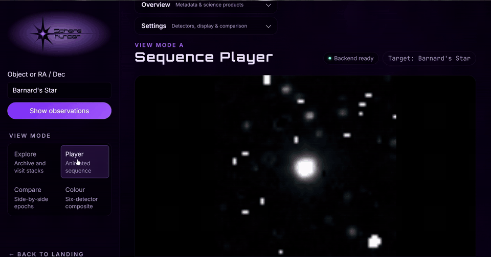
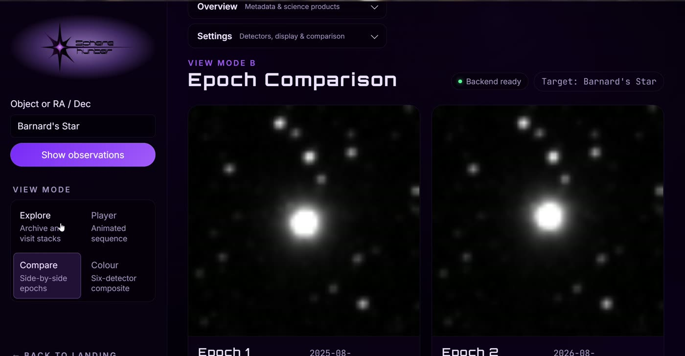
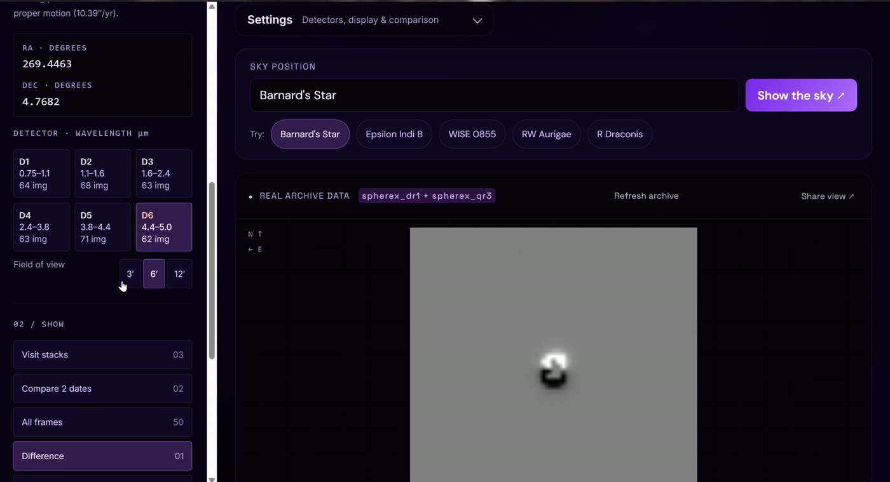
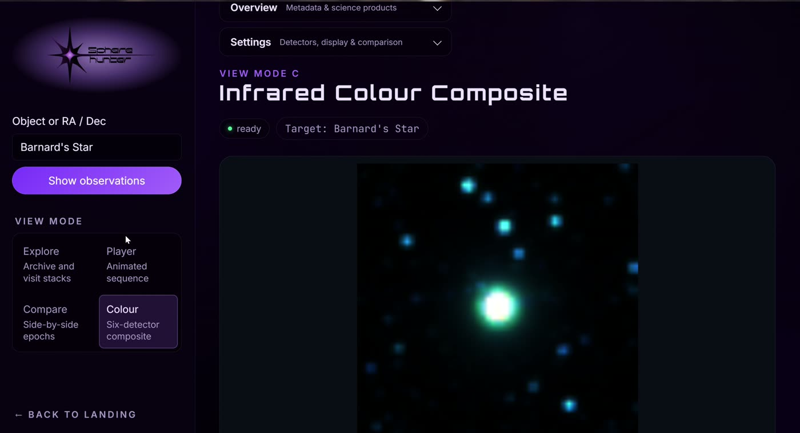

<div align="center">

# Sphere Hunter

**A public blink comparator for NASA's SPHEREx infrared sky**

NASA Space Apps Challenge 2026 · *Planet X and SPHEREx* · Team **Apollo 404**, Bishkek



</div>

## The idea

SPHEREx maps the whole sky every six months in 102 infrared colours. Stars, brown dwarfs, comets and asteroids that move or change hide among more than a billion sources, and the raw archive is hard to use for anyone who is not an astronomer.

Sphere Hunter turns it into something anyone can explore. Type an object name or sky coordinates: the app finds every SPHEREx image of that spot in the NASA/IPAC IRSA archive, downloads it **live**, aligns all frames on one sky grid, stacks each survey visit and lets you blink them in time. Nothing is prepared in advance; any position works.

## What you can do

| | |
|---|---|
|  | **Compare.** Two visits side by side, half a year apart. Barnard's Star visibly shifts against the background stars. |
|  | **Explore and Difference.** Every visit stack and every single frame; *last minus first* leaves a black-and-white pair where something moved. |
|  | **Colour.** All six detectors (0.75–5 µm) combined into one infrared colour image; cold brown dwarfs stand out as red. |

Also: an animated **Player**, a per-target **spectrum** from all six detectors, an all-sky **Sky Map** (Aladin Lite, AllWISE), a predicted-position ring from catalog proper motion, detector and field-of-view selectors, and shareable links for every view.

## How it works

```
name or RA/Dec ──► SIMBAD (position + proper motion)
                   │
                   ▼
            IRSA SIA search ──► every SPHEREx image of the spot (DR1 + QR)
                   │
                   ▼
   download only what is needed: IRSA cutouts (~120 KB of each 4 MB file),
   NASA's public S3 copy as automatic fallback
                   │
                   ▼
   ZODI background removed · bad pixels masked · aligned on a fixed sky grid
   frames < 30 days apart = one visit · inverse-variance stack, sigma clipping
                   │
                   ▼
   PNG frames, visit stacks, difference, colour, spectrum ──► React viewer
```

The first request for a new position takes 30–60 s; afterwards it is served from the cache instantly. Details of every step: [backend/README.md](backend/README.md).

**Checked against catalogs:** Barnard's Star moved 9.3″ in one year in our stacks (10.3″ expected from its proper motion); WISE 0855 and Epsilon Indi B move as predicted. See the [roadmap status](backend/docs/ROADMAP.md) and the [Gaia check for Epsilon Indi B](backend/docs/gaia-validation.md).

## NASA and partner data

- **SPHEREx Spectral Images** (Level 2, DR1 and quick-release), NASA/IPAC Infrared Science Archive (IRSA), through the SIA and cutout services and the public `nasa-irsa-spherex` S3 bucket
- **AllWISE** sky map (HiPS) for the Sky Map view
- **Gaia DR3** (ESA) reference stars and **SIMBAD** (CDS) for names, positions and proper motions

> This research uses data from the SPHEREx mission, funded by NASA and managed by the Jet Propulsion Laboratory, California Institute of Technology. Data are served by the NASA/IPAC Infrared Science Archive.

## Repository

```
backend/
  app/         FastAPI service and the image pipeline
  frontend/    React + Vite viewer
  scripts/     data probes, validation and benchmarks
  tests/       pytest suite
  docs/        validation reports, architecture, roadmap
docs/media/    screenshots and the demo animation
```

## Use of AI

We used AI assistants (Claude, Codex, Gemini) for research, data analysis and writing code. The team reviewed, ran and tested all of it against real archive data.

## Limitations

Sphere Hunter is an exploratory tool. Differences, spectra and aperture measurements are quick-look diagnostics: they show where to look, but they are not a discovery, a calibrated spectrum or a significant motion measurement.
